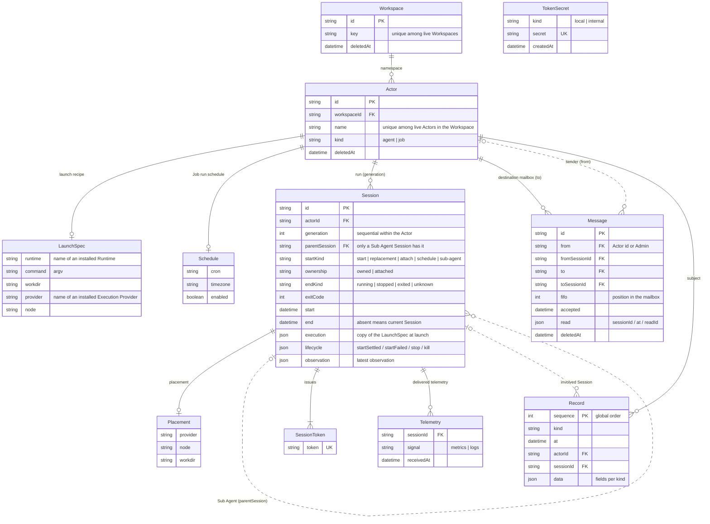

# Feld concept ER diagram

This diagram shows the core objects Feld persists and the relationships between them. The meaning of each field follows [`glossary.md`](glossary.md); only the fields that determine identifiers and relationships are listed here.

## Notes on relationships

- Each Actor has at most one Session without `end`, and this is the current Session slot. The Session of the next generation enters the same slot
- Only an Actor of kind `job` has a Schedule. An Actor without a launchSpec is always an Agent created by `attach` alone
- A Sub Agent Session points to its parent with `parentSession` and has no Placement, token, or Telemetry; its lifecycle and observation belong to the parent Session
- A Session token is reissued on every `attach`, so one Session can have several
- Session metrics, Runtime metrics, and the account's quota are all values derived from Telemetry at read time and do not appear as entities
- TokenSecret is the secret of the daemon's tokens (local token, internal token) and is held apart from the Session token, independent of the core objects. The browser token is also held as a hash independent of the core objects
- When a Message's `from` is `Admin`, it has no reference to a sender Actor or Session. `toSessionId` and the `sessionId` in `read` point to a Session of the destination Actor
- The `spawned` record has `spawner` (an Actor's `id` or `Admin`) and `spawnerSessionId` in `data`
- Admin, Runtime, and Execution Provider are not persistent objects. Runtime and Execution Provider are referenced by name from launchSpec and Placement, and Admin appears as a value of `from` and `spawner`
