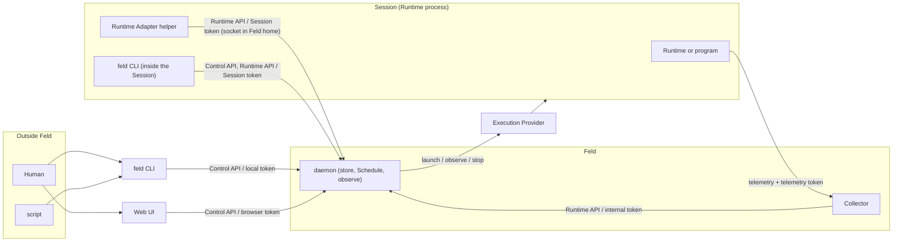

# Feld concept glossary

Feld is German for "field" and stands for the "field" in which Agents run and act on one another.

This document collects the concepts that make up Feld and their meanings. It defines them in this order: active principals and tokens, APIs, core objects, derived values, and abstractions over supported products. Operations on core objects are listed in the [Feld Daemon feature list](daemon-features.md), and relationships between core objects are shown in the [ER diagram](er-diagram.md).

## Contents

- [Overview](#overview)
  - [Active principals](#active-principals)
  - [Admin](#admin)
  - [daemon](#daemon)
- [token](#token)
  - [local token](#local-token)
  - [Session token](#session-token)
  - [internal token](#internal-token)
  - [browser token](#browser-token)
- [API](#api)
  - [Control API](#control-api)
  - [Runtime API](#runtime-api)
- [Core objects](#core-objects)
  - [Workspace](#workspace)
  - [Actor](#actor)
    - [kind](#kind)
    - [launchSpec](#launchspec)
    - [Schedule](#schedule)
  - [Session](#session)
    - [ownership](#ownership)
    - [Placement](#placement)
    - [Sub Agent Session](#sub-agent-session)
    - [observation](#observation)
    - [log](#log)
      - [transcript](#transcript)
    - [Telemetry](#telemetry)
  - [Message](#message)
    - [mailbox](#mailbox)
  - [record](#record)
    - [spawned](#spawned)
- [Derived values and marks](#derived-values-and-marks)
  - [outcome](#outcome)
  - [attention](#attention)
  - [turn](#turn)
  - [waiting count](#waiting-count)
  - [unread-mail mark](#unread-mail-mark)
  - [skip mark](#skip-mark)
  - [overdue mark](#overdue-mark)
  - [unlinked mark](#unlinked-mark)
  - [Session metrics](#session-metrics)
  - [Runtime metrics](#runtime-metrics)
- [Supported products](#supported-products)
  - [Runtime Adapter](#runtime-adapter)
    - [Runtime](#runtime)
  - [Execution Provider](#execution-provider)

## Overview

### Active principals

The daemon is at the center of Feld, and the following principals run around it.



| Principal | Role | APIs called | token |
|---|---|---|---|
| Human | Operates Feld from the terminal CLI and the Web UI | Control API | local token, browser token |
| script | Calls the CLI from outside Feld to run an Agent Loop | Control API | local token |
| feld CLI | A thin client that calls the daemon's API. Used by humans and scripts from outside, and by Actors from inside a Session | Control API, Runtime API | local token, Session token |
| Web UI | A mostly read-only screen served by the daemon. Opens on the daemon's machine, or on another machine through an HTTPS proxy | Control API | browser token |
| [daemon](#daemon) | The core of Feld. Stores core objects, launches and observes Sessions, and provides the APIs | | |
| Collector | A process that receives the Runtime's telemetry and forwards it to the daemon | Runtime API | internal token |
| [Execution Provider](#execution-provider) | A component that launches, identifies, observes, and stops the Session's underlying entity as the daemon directs | | |
| Session | One run of an Actor. A Runtime or program process | | |
| [Runtime](#runtime) | The Coding Agent product that runs inside the Session | | telemetry token (in the telemetry header) |
| [Runtime Adapter](#runtime-adapter) helper | Runs as a child process of the Runtime and mediates between the Runtime and the daemon | Runtime API | Session token |

### Admin

A caller that holds a [local token](#local-token) or a [browser token](#browser-token) and is allowed the daemon's operations other than the Runtime API and the spool path (pairing management is limited to the local token, and Sign out to the browser token). A principal calling with these tokens is recorded as `Admin`, and `Admin` appears in the `spawner` of [spawned](#spawned) and in the `from` of a [Message](#message). Examples are `feld actor start` and `feld message send` typed by a human in an outside terminal, and operations in the Web UI. A script that creates Actors and sends Messages to run an Agent Loop is one example of using the CLI as Admin. Admin is a principal outside the Actors, and only Actors, which have a mailbox, are Message recipients.

### daemon

The process that is the core of Feld. It stores core objects, launches and observes Sessions, and provides APIs on two surfaces: the [Control API](#control-api) and the [Runtime API](#runtime-api). The daemon also performs Schedule ticks and periodic observation.

## token

Callers of the daemon are distinguished by four token kinds. The token attached to a request is the basis of the caller's identity; the request body and environment variables play no part in identity. Issuance, distribution, and revocation are detailed in [auth.md](../design/auth.md).

| token | Used by | Caller recorded as |
|---|---|---|
| [local token](#local-token) | Human, script, CLI | `Admin` |
| [Session token](#session-token) | The Actor inside a Session, the Runtime Adapter helper | The Actor of that Session |
| [internal token](#internal-token) | Collector | |
| [browser token](#browser-token) | The browser that opens the Web UI | `Admin` |

### local token

Used by the CLI and scripts. The daemon issues it (timing in [`auth.md`](../design/auth.md#local-token)) and stores it owner-only in `$FELD_HOME/admin/`. It allows the daemon's operations other than the Runtime API, the spool path, and Sign out, and the caller is recorded as [Admin](#admin).

### Session token

A token that uniquely identifies one Session. The daemon issues it at the time of the Session's `start` or `attach`; it is passed through an environment variable at launch for an `owned` Session, and returned in the response for `attach`. Every operation called from inside the Session uses it, and the caller is recorded as that Session's Actor. It is valid only while the Session has no `end` and it is the token most recently issued for that Session.

The Runtime's telemetry header carries a telemetry token derived one-way from the Session token. The telemetry token is used only for telemetry attribution, and the daemon's API does not accept it.

### internal token

Used by the Collector to forward telemetry. The daemon issues it on every start and places it only in the Collector's configuration. It opens only the telemetry endpoint; telemetry attribution is decided by the telemetry token in the telemetry header.

### browser token

Used by the browser that opens the Web UI. It is issued only in exchange for a short-lived, single-use pairing code that a local token caller issues on the daemon's machine, and is carried only as the pair of an HttpOnly cookie and a key kept in storage confined to the Web UI's origin. Each browser has a name, and the token stays valid across daemon start / stop for 7 days after last use (at most 30 days from issuance). It allows the same operations as the local token except pairing management and Sign out, and the caller is recorded as [Admin](#admin). Only the local token issues and revokes browser tokens and pairing codes.

## API

| Surface | Callers | Target | token |
|---|---|---|---|
| [Control API](#control-api) | CLI, Web UI, the Actor inside a Session | Feld's core objects | local token, browser token, Session token |
| [Runtime API](#runtime-api) | The Runtime Adapter helper running beside the Session, Collector | The caller's own current Session (self) | Session token (internal token for the Collector) |

### Control API

The surface that reads and writes Feld's core objects. The token the caller used becomes the value of the `spawner` of [spawned](#spawned), the `from` of a [Message](#message), and the requester of stop / kill. Calling with a Session token makes it that Session's Actor; calling with a local token or browser token makes it `Admin`.

### Runtime API

The surface that delivers facts to the daemon from beside the Runtime and receives Messages. It handles telemetry, Runtime identity, receiving Messages (`recv`), and recording reads (`read`). Its target is always the caller's current Session, called self and used as the subject. self is determined from the Session token the caller presents (the telemetry token for telemetry), and if the token's Session is closed, there is no self.

## Core objects

What Feld holds persistently.

### Workspace

A namespace for Actor names. Every Actor belongs to exactly one Workspace, and `name` is unique within the Workspace. A Workspace key follows the same grammar as an Actor's `name`. An Actor in another Workspace is referred to by the qualified name `workspace/actor`. A new Actor is created in the default Workspace unless otherwise specified.

The default Workspace always exists. `delete` of a Workspace is accepted only for a non-default Workspace that has no live Actors. A deleted Workspace's key leaves the uniqueness constraint, and `create` with the same key makes a different Workspace. A deleted Workspace and its history remain.

### Actor

A durable identity that Feld handles. It has `id`, `name`, `kind`, an optional `launchSpec`, for a Job an optional [Schedule](#schedule), [grants](#grants), and an optional [acceptFrom](#acceptfrom); it holds no execution state.

- `id`: An opaque, immutable ID assigned by Feld. Sessions, Messages, and records reference Actors by `id`, and display resolves it to `name`
- `name`: A name unique among live Actors in the Workspace. Matches `^[a-z0-9][a-z0-9-]*$`. It can be changed with `update`, and history and the mailbox referenced by `id` appear under the new name
- `deletedAt`: The time of soft delete

[Sessions](#session) carry the actual execution, and the Actor is the permanent principal that groups them. Every Actor has a [mailbox](#mailbox) and exactly one current Session slot.

`create` against a live Actor of the same name replaces the declaration while keeping the same `id`, and keeps grants and, if not given, acceptFrom. Changing an Actor's `name` and `delete` are accepted only when the current Session is not running. A deleted Actor leaves the targets of `start` and of Message recipients, and also leaves the `name` uniqueness constraint. `create` with the same `name` makes a separate Actor with a new `id`, and a deleted Actor's history is traced with `get` by its `id`.

#### kind

The type of an Actor. Declared with `create` and fixed thereafter.

- `agent`: An Actor whose central execution is an Agent Loop. The Session is a loop and continues until a stop / kill request. In addition to those `start`ed by Admin or other Sessions, a Runtime that a human launched for themselves and then `attach`ed is also an `agent`
- `job`: An Actor that runs a bounded program. The Session is a bounded run that ends on its own, and the exit code is the result. A Job with a [Schedule](#schedule) is launched by Feld via cron. A Job without a Schedule has its Session started by a request from Admin or another Session

Among the shared lifecycle, the central rule that varies by kind is "how to interpret an `owned` Session ending without a request". `job` reads it as normal completion and takes the exit code as the outcome. `agent` reads it as an abnormal end. The other things that vary by kind are: launchSpec has `runtime` for `agent` and `command` for `job`; only `job` can have a Schedule; only `agent` can be `attach`ed; and the default launch behavior of `create` (`agent` `start`s on creation, `job` is only created). The presence of a mailbox, the number of current Session slots, admission, fence, token, and Provider do not depend on kind.

#### launchSpec

The definition Feld uses to launch this Actor's Sessions. It has `runtime` (with `runtimeSettings` and `trustWorkdir`) or a `command` argv, `workdir`, `env` (environment variables added to the Session's launch environment), `provider`, `node`, and `providerOptions` (provider-specific options). `runtime` is the name of an installed [Runtime](#runtime) and `provider` the name of an installed [Execution Provider](#execution-provider); each receives `runtimeSettings` and `providerOptions` respectively as is. `trustWorkdir` (default false) is a declaration by Admin that settings the workdir brings into the Runtime take effect without confirmation; how it is handled is decided per Runtime Adapter. `create` provides it; `update` changes it per top-level field, or re-running `create` replaces it wholesale. It is not a single launch request but a launch recipe permanently tied to the Actor, and `start`, `restart`, and Schedule ticks all read it to launch a Session. A Session's `execution` is a copy of the launchSpec at launch time, and a Session's [Placement](#placement) is the binding Feld decided at launch from the launchSpec's provider, node, and options. Changing the launchSpec later does not change past Sessions.

Feld can launch only Actors that have a launchSpec. `attach` decides only the Session's `execution` and leaves the Actor's launchSpec as is. An Actor without a launchSpec is limited to an Agent created only by `attach`; a Job always has a launchSpec.

#### Schedule

The part of a Job's definition that represents its run schedule. It belongs to the Actor alongside launchSpec, is declared with `create`, and changed with `update`. It has `cron`, `timezone`, `enabled`, `createdAt`, and `pausedAt` / `enabledAt`. `timezone` is an IANA name and required; when omitted, the daemon resolves it at creation to its own local timezone and stores that. Toggling `enabled` is `pause` / `resume`.

For a Job with an `enabled` Schedule, Feld launches a Session from the [launchSpec](#launchspec) when cron fires. This launch follows admission, and a rejected tick remains as `schedule.skipped` in [record](#record). An executed tick remains as a Session whose `startKind` is `schedule`. The next run is a derived value. A tick whose scheduled time passed while the daemon was running, yet left no Session, `schedule.skipped`, or `schedule.missed`, is an overdue tick, which is also a derived value. When the daemon's Scheduler does not wake past the scheduled time of the tick it is waiting for, or ends other than by shutdown, it records the reason in the daemon log and restarts. Ticks whose scheduled time arrived before the restart, and ticks woken 2 minutes or more past their scheduled time due to host sleep and the like, are not fired and remain as `schedule.missed` in record.

#### grants

The set of operations on other Actors in the same Workspace that [Admin](#admin) allows an Actor's Sessions. It consists of `read`, `control`, `manage-agent`, and `manage-job`. It belongs to the Actor's declaration alongside launchSpec; only Admin sets it with `create` and `update`, and `update` replaces it wholesale.

#### acceptFrom

The list of `name`s of Actors in the same Workspace from which an Actor accepts Messages. Messages from [Admin](#admin) are always accepted. An Actor that omits it accepts from all Actors in the same Workspace. It belongs to the Actor's declaration alongside launchSpec; Admin and Sessions that can manage the Actor ([grants](#grants) `manage-agent` / `manage-job`) set it with `create` and `update`, and `update` replaces it wholesale or returns it to omitted.

### Session

One run of an Actor. It occupies the Actor's current Session slot, and the next generation's Session enters the same slot. Records related to a Session fall into three lines.

```
Session
├─ record          Facts written by Feld. Belong to the Actor; read filtered by Session
├─ log             What the Session emitted. Read with session log
│   ├─ transcript  agent-runtime Session. The Runtime Adapter projects the transcript file into a sequence of transcript entries
│   └─ output      program Session. stdout / stderr
└─ Telemetry       Measurements emitted by the Runtime. Derived into Session metrics
```

The fields are as follows.

- `start` / `end`: Start time and end time. No `end` means running. When `endKind` is `unknown`, `end` is the time Feld stopped tracking
- `startKind`: How it started
  - `start`: Feld launched the first generation on a `start` request
  - `replacement`: Feld launched the next generation for an Actor that has a previous generation. Occurs on `start` and `restart` requests
  - `attach`: Feld attached to an execution that was already running
  - `schedule`: Feld launched it on a Schedule cron fire
  - `sub-agent`: Started as a Sub Agent inside the Runtime. See [Sub Agent Session](#sub-agent-session)
- `ownership`: The authority Feld has over the execution. See [ownership](#ownership)
- `endKind`: How it ended. Distinguished by whether Feld recorded a stop / kill request before the end
  - `running`: Not ended
  - `stopped`: End with a request. Before `end`, `lifecycle.stop` or `lifecycle.kill` was accepted and the Provider confirmed the end
  - `exited`: End without a request. Feld does not distinguish natural exit, a Runtime stop input, or a crash
  - `unknown`: Closed without being able to prove it ended. A Session whose observation is `lost` / `mismatched` is closed when the next launch request passes admission, or, if `owned`, when a stop / kill is accepted. `exitCode` is null
- `exitCode`: The exit code the Provider reported. Null when the Provider could not report it, distinct from non-zero. Recorded even for `stopped`, but not read as the result
- `planned`: When `startKind` is `schedule`, the tick's scheduled time
- `execution`: What is running. For `owned`, a copy of the launchSpec at launch time; for `attached`, derived from the `runtime` declared at attach, always `agent-runtime`
  - `type`: The form of execution
    - `agent-runtime`: A Coding Agent Runtime that has a [Runtime Adapter](#runtime-adapter). The Adapter delivers model, transcript, and metrics
    - `program`: Any argv without a Runtime Adapter
  - `label`: Display name
  - `command`: The argv of the launched `program`. Null for `agent-runtime`, where the Adapter manages the launch
  - `ai`: Whether the execution calls a model
- `model`: The pair of Runtime name and model name. Present when `execution.type` is `agent-runtime`
- `placement`: Where the execution is placed. See [Placement](#placement)
- `lifecycle`: The Control Plane's records about start and stop
  - `startSettled`: The time the Provider observed `running` and the start was settled
  - `startFailed`: The time it was settled that the Session did not start, because the Provider finished the launch without creating the entity, or it stopped before asking the Provider to launch. This Session has no `startSettled`, and its result is shown as start failed
  - `stop` / `kill`: The stop / kill request and how it played out. Each is an optional record of the same shape: `accepted` (time the request was accepted), `requesterSessionId` (the requesting Session; null for a request from Admin), `attempt` (what the Provider tried), `observed` (what the Provider confirmed). If there is no `end` after a stop is accepted, a kill is accepted. A request to a Session whose observation is `lost` / `mismatched` records `attempt` as `nothing to kill` and `observed` as that kind, and closes the Session. Any other Session is closed when the Provider observes `gone` (as `unknown` when it observes `lost` / `mismatched`). A request the Provider could not answer records `attempt` as null and `observed` as `unknown`, and is retried on the next request of the same kind
- log: What the Session emitted. See [log](#log)
- Telemetry: Telemetry attributed to the Session. See [Telemetry](#telemetry)
- metrics: Time series derived from Telemetry. See [Session metrics](#session-metrics)
- observation: Observation by the Execution Provider. See [observation](#observation)

#### ownership

The authority Feld has over the execution. Recorded at launch as a persistent fact of the Session and never changed afterwards. It is `attached` when `startKind` is `attach`, and `owned` when it is `start` / `replacement` / `schedule`. A Sub Agent Session has none, since Feld neither launches nor stops it.

- `owned`: Feld launched it and has authority to stop it
- `attached`: Attached to an existing execution; Feld neither launches nor stops it

ownership takes effect in these two places.

- Whether an operation is allowed: stop / kill and `restart` are accepted only for `owned` Sessions. Feld does not stop an execution it attached to
- Interpreting the end: When an `owned` Session ends without a stop / kill request, `succeeded` / `failed` / `exited` is derived per the kind rule, and it can become subject to [attention](#attention). For an `attached` Session, Feld has no authority to stop it, so the "without a request" distinction does not hold, and it is `ended` regardless of kind. See [outcome](#outcome)

ownership and [Placement](#placement) are separate axes. Placement is the binding of where the Session runs; ownership is the relationship between Feld and the execution. The `created` (made by Feld) / `existing` (pre-existing) distinction Placement holds per resource is the resource's origin, a separate field from the Session's ownership.

#### Placement

The Execution Binding that represents where a Session runs. Only Sessions have it; Actors do not. For an `owned` Session, Feld decides it from the [launchSpec](#launchspec) when the launch request is accepted, and the fields that identify the entity (incarnation) are recorded after the Provider creates the resources, in the same transaction as the first observation. For an `attached` Session, it is received at attach.

- `provider`: The name of the [Execution Provider](#execution-provider)
- `node`: The Node running it
- `workdir`: The working directory

Additional fields per provider are defined by the Provider, and Feld stores them as is. The per-resource `created` / `existing` origin and the incarnation are also included here.

#### Sub Agent Session

The Session of a Sub Agent launched inside the Runtime. `parentSession` points to the parent Session, and `startKind` is `sub-agent`. `start` / `end` / `parentSession` are drawn from the transcript, and `end` is the time the parent Session's transcript entry indicated the Sub Agent's completion. It runs within the parent Session's Placement (`placement` is null), and lifecycle, observation, and ownership belong to the parent Session.

#### observation

A fact that the Execution Provider observed about the Session's entity from outside. It has `kind`, the recording time, and `detail`, which the Provider stated along with the kind. It is independent of the Session's lifecycle and is used for launch request admission.

- `running`: The recorded incarnation is running
- `relocated`: Running, but moved from the recorded location
- `gone`: Ended
- `lost`: Lost track of the entity; unknown whether it ended
- `mismatched`: A different entity is at the recorded location
- `unknown`: Could not observe

The daemon observes periodically, and `observe` can trigger an observation now. The `observation` in [record](#record) is written only when the kind changes from the previous one, including the first `running` (`startSettled`). The latest observation time is kept as `observation.at`, and the time the current kind was recorded as `observation.since`. `detail` is in the Provider's words and is shown as is alongside the kind.

Admission of a launch request (`start`, the next generation of `restart`, a Schedule tick, `attach` to an Actor of the same name) is decided by the current Session's latest observation. If there is no current Session, it is allowed.

- `running` / `relocated`: Rejected. The entity is running
- `gone`: Allowed
- `lost` / `mismatched`: Allowed. The previous Session is closed with `endKind` = `unknown` before launch
- `unknown`, or no observation before `startSettled`: Rejected. Prompts `observe`

When `attach` points to the same Runtime process as an `attached` current Session, it is not subject to admission; no Session is created and that Session's token is reissued.

A closed Session is not observed again, and it stays closed even if the same incarnation keeps running.

#### log

What the Session emitted. For an agent-runtime Session it is the [transcript](#transcript); for a program Session it is output (a sequence of stdout / stderr lines). `session log` looks at the Session's `execution.type` and reads one or the other.

##### transcript

The log of an agent-runtime Session. The file of dialogue history the Runtime writes itself is called the transcript file; each line the Runtime Adapter projects into a common shape on every read is a transcript entry, and their sequence is the transcript. Feld only knows the transcript file's location via the Runtime identity and does not store its content. The Console display, [turn](#turn), and [Sub Agent Session](#sub-agent-session) are all drawn from transcript entries. The common shape is described in [plugin.md](../design/plugin.md#common-shape-of-a-transcript-entry).

#### Telemetry

Telemetry emitted by the Runtime and attributed to a Session by the [telemetry token](#session-token). Both the metrics and logs exported by the Runtime's OTLP exporter and gauges produced by Runtime Adapter components arrive through the Collector, and are stored as received, tied to the Session. Telemetry without a token, and telemetry with the telemetry token of a closed Session, are not stored. [Session metrics](#session-metrics), [Runtime metrics](#runtime-metrics), and account quota are all derived from Telemetry at read time, and aggregated values are not stored. A Sub Agent Session has no Telemetry; its telemetry is included in the parent Session's Telemetry. The path and attribution decisions are described in [otel.md](../design/otel.md), and the derivation rules in [metrics.md](../design/metrics.md).

### Message

A message sent between Actors, or from Admin to an Actor. It has the following fields.

- `from`: The sender. An Actor's `id`, or `Admin`
- `fromSessionId`: The sender's Session at acceptance time. Null for `Admin`
- `to`: The recipient Actor's `id`
- `toSessionId`: The recipient's current Session at acceptance time. Null if none
- `accepted`: The time Feld accepted it
- `label`: A name the sender gives to the kind of Message. Follows the same grammar as an Actor's `name`. Optional; null if absent. Used to filter lists
- `queued`: The fact that the Runtime holds the body in its own queue and passes it to the model on a later input. Recorded before `read`. `sessionId`, `at`. If the Session closes with `endKind` `stopped` or `exited` without a `read`, it is removed and the Message waits for the next Session. The Runtime of a Session closed with `unknown` may keep running, so its `queued` stays until `read`
- `read`: The read record. The fact that the Session's Runtime received the body, recorded after confirming receipt. One per Message. `sessionId`, `at`, `readId` (an ID per record), `fifo` (position number in the mailbox; integer)
- `preview`: An excerpt of the body
- `anchor`: A Feld ID that a transcript entry cites

`from` and `fromSessionId` are determined by the `send` token. The recipient Session takes Messages without a `read` from the mailbox in FIFO order with `recv`, and records the read with `read` after receiving the body. Whether the Runtime Adapter helper receives it or the model receives it with `feld self message recv`, the record is the same. `waiting` (unread) is derived from "accepted and has no read". `delete` is accepted only for Messages with no read and no queued.

#### mailbox

The collection of Messages addressed to an Actor. Every Actor has one, and it accepts Messages regardless of whether there is a current Session. The Control API reads it as a list of Messages filtered by recipient; the Runtime API takes `waiting` Messages from the self Actor's mailbox in FIFO order.

### record

Facts Feld itself left. It is a separate line from the dialogue history the Runtime writes ([transcript](#transcript)), and only what is in Feld's store is called a record.

Records remain for both Agents and Jobs, and have `kind`, a time, Workspace, and the Actor's `id`, plus the related Session if any. All records have a global order along the time axis, and the continuation can be read from a cursor pointing to a position. They are read with a single search filtered by Workspace, Actor, Session, kind, and time range; per-Session history and the list of skipped ticks are both results of this search.

There are 11 kinds.

- `session.started`, `session.ended`
- `spawned`: See [spawned](#spawned)
- `message.accepted` (shown as waiting while there is no read), `message.sent`, `message.read`. They have the Message's ID and `from` / `to`; the body is held by the [Message](#message)
- `stop.requested`, `kill.requested`
- `observation`: Only when the [observation](#observation) kind changes
- `schedule.skipped`: A [Schedule](#schedule) tick rejected by admission
- `schedule.missed`: A [Schedule](#schedule) tick not fired because the Scheduler stopped or woke 2 minutes or more past the scheduled time, with the reason. Has no Session

#### spawned

The record of the fact that a Session started by request. One remains per `start` and `restart` request. It has the following fields.

- `spawner`: The requesting Actor's `id`, or `Admin`
- `spawnerSessionId`: The spawner's Session at the time the request was accepted. Null for `Admin`
- `target`: The launched Actor's `id`
- `session`: The created Session
- `at`: The time

`spawner` and `spawnerSessionId` are determined by the request's token.

## Derived values and marks

Values derived at render time from facts of core objects. A derived value is not mixed with the facts it came from (`endKind`, `exitCode`, observation, record), and is always shown alongside those facts.

### outcome

A derived value representing a Session's result. Derived from `endKind`, `exitCode`, ownership, and the kind rule.

- `running`: Running
- `stopped`: Ended after a stop / kill request. A normal end regardless of kind
- `succeeded`: An `owned` Job ended without a request with exit 0
- `failed`: An `owned` Job ended without a request with a non-zero exit code
- `exited`: An `owned` Agent ended without a request
- `ended`: An `attached` Session or a Sub Agent ended with other than `endKind: unknown`. Feld has no authority to stop it, so the "without a request" distinction does not hold, and it takes this value regardless of kind
- `unknown`: The result cannot be determined. There are two cases: `endKind` is `unknown` and the end cannot be proven (regardless of ownership), and an `owned` Job ended without a request but `exitCode` is null because the exit code could not be obtained. Which one is read from the `endKind` and `exitCode` shown alongside. A Session with `startFailed` is shown among these as start failed, with the observation's `detail` attached as the reason

### attention

A derived value indicating that an Actor needs attention. Used to order Actors. It evaluates the Actor's latest Session (excluding Sub Agent Sessions; the current Session if there is one), and the Actor is in attention if any of the following reasons applies.

- Reason from outcome: the [outcome](#outcome) is `failed`, `exited`, or `unknown`
- Reason from observation: the Session is current and its latest [observation](#observation) is `lost` or `mismatched`

[unread-mail mark](#unread-mail-mark), [skip mark](#skip-mark), and [unlinked mark](#unlinked-mark) are marks separate from attention.

### turn

A derived value indicating whether the current Session's Runtime is in the middle of a response or waiting for input. A current Session whose `execution.type` is `agent-runtime` has it, derived from the last entry of the [transcript](#transcript) projected by the Runtime Adapter. Input, model response, tool call, and tool result entries are counted; snapshots, mode changes, meta entries injected by the Runtime, and the like are skipped.

- `responding`: The last entry is an input (a human prompt, a Runtime notification), a tool call, a tool result, or a response that follows a tool call or consists only of thinking
- `waiting-input`: The last entry is a model response not stopped at a tool call
- `unavailable`: The transcript file cannot be read. The reason is shown by the [transcript state](../design/plugin.md#transcript-states)

turn is derived only from facts written in the transcript file. A Session read returns turn along with the time of the entry it was derived from (the last activity time) attached to the Session. Elapsed time is read from this time, and Admin judges progress. turn is not among the reasons for attention.

### waiting count

The number of `waiting` Messages in the Actor's [mailbox](#mailbox). It is attached to the Actor regardless of whether there is a current Session, and reports delivered to a stopped Job are also found here.

### unread-mail mark

A derived mark indicating that there are Messages the current Session has not yet read. Shown only when there is a current Session and there are `waiting` Messages. While the waiting count indicates "the mailbox has unread Messages", this mark indicates "the running Session has not read them".

### skip mark

A derived mark indicating that a Schedule tick was skipped. Shown only when there is a current Session and a tick was skipped after it started.

### overdue mark

A derived mark indicating that the Schedule has an [overdue tick](#schedule). It signals from outside that the Scheduler has failed to fire ticks.

### unlinked mark

A derived mark indicating that the current Session is not yet linked to the Runtime. Shown only when the current Session is an `owned` `agent-runtime` and the Runtime identity (the Runtime-side session id and the transcript file location, delivered by the [Runtime Adapter](#runtime-adapter)) has not yet arrived. If it stays after the short period right after launch, the Runtime is waiting for a human response before linking with Feld (such as confirming whether to trust the workdir), and Messages do not reach the Runtime either. How to respond is described in each Runtime Adapter's design ([Claude Code](../design/adapter/claude-code.md#workdir-trust), [Codex](../design/adapter/codex.md#workdir-trust)).

### Session metrics

A derived value that projects the Session's [Telemetry](#telemetry) into per-metric time series at read time. The Session itself does not hold it.

- `status`: State per Session and per metric
  - `n/a`: The execution or Runtime has no such metric. `program` Sessions, Sub Agent Sessions (Telemetry is included in the parent Session), metrics the Runtime does not emit, and Runtimes for which Feld has no metric rules
  - `unavailable`: A signal that should be obtainable is temporarily or permanently unavailable
  - `reported`: A value has been reported
- `source`: A string giving the basis of `status`
- metric: Depends on what the Runtime Adapter delivers
  - token usage: `input`, `output`, `cache_read`, `cache_creation`. The sum of the four is `total`
  - context window: `size` and `used_percent`. Grows as the Session progresses and drops on compact
  - cost: Estimated cost
  - active time: Time the Runtime was active
  - tool calls: Number of tool invocations
  - API errors, API request latency, prompt cache hit rate: Quality of API calls
- series: A time series with the range cut into bins

The source of each metric is described in the Runtime Adapter files ([adapter/claude-code.md](../design/adapter/claude-code.md#metrics), [adapter/codex.md](../design/adapter/codex.md#metrics)), and aggregation in [metrics.md](../design/metrics.md).

### Runtime metrics

A derived value attributed to a [Runtime](#runtime). Derived at read time from the [Telemetry](#telemetry) of that Runtime's Sessions. Metrics are aggregated per Session account, across Sessions, by each metric's rule; the account's rate limit (5-hour / 7-day quota) lays out the values the Runtime reported as is in a time series per reporting account.

## Supported products

Feld connects to supported products with a [Runtime Adapter](#runtime-adapter) and an [Execution Provider](#execution-provider). Each is installed as one Plugin per product, and launchSpec's `runtime` and `provider` select them by name. The core holds the rules for record, admission, token, and metrics; the Plugin holds product-specific knowledge. Plugin layout and contracts are described in [plugin.md](../design/plugin.md), and per-product details in [adapter/claude-code.md](../design/adapter/claude-code.md), [adapter/codex.md](../design/adapter/codex.md), [provider/tmux.md](../design/provider/tmux.md), and [provider/herdr.md](../design/provider/herdr.md).

### Runtime Adapter

The component through which Feld connects to a Coding Agent Runtime. There is one per Runtime, used in Sessions whose `execution.type` is `agent-runtime`. It consists of two sides.

- The launching side: assembling launch arguments and environment, associating the Runtime identity (the Runtime-side session id, the transcript file location, `model`) with the Session, and projecting the transcript file into the [transcript](#transcript)
- The side running beside the Runtime: a helper running as a child process of the Runtime. With the Session token it calls the [Runtime API](#runtime-api) through the socket in Feld home, delivers the Runtime identity, long-polls the mailbox to notify the Runtime of Messages, and attaches the telemetry token to telemetry

In addition, it holds the input that stops the Runtime, the matching that identifies the Runtime process on `attach`, and the Runtime-side preparation for `attached` Sessions.

#### Runtime

An installed Runtime Adapter. Referred to by its name, which launchSpec's `runtime` and the Session's `model` reference. It is what [Runtime metrics](#runtime-metrics) are attributed to.

### Execution Provider

The component that launches, identifies, observes, and stops a Session's entity. There is one per Provider, and its name is specified in Placement's `provider`. The Provider handles the following.

- Launch: selects or creates resources from launchSpec's `providerOptions` and launches the Session's process
- Identification: records in Placement the `created` / `existing` origin per resource and the incarnation that identifies the entity
- Observation: queries the incarnation and answers with the [observation](#observation) kind and `detail`
- Stop: conveys stop and kill to the entity and answers with what it tried and what it confirmed
- attach: identifies an existing entity from the caller's environment or specification and assembles the Placement

The provider-specific fields of Placement are defined by the Provider.
